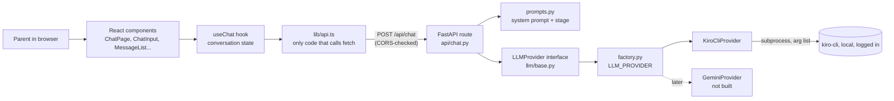
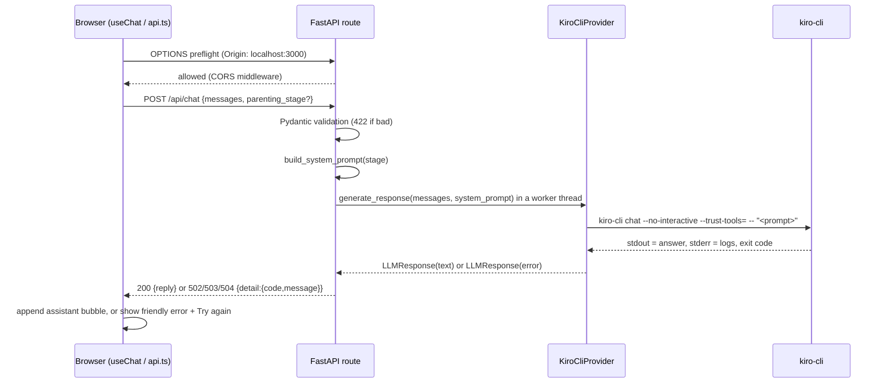
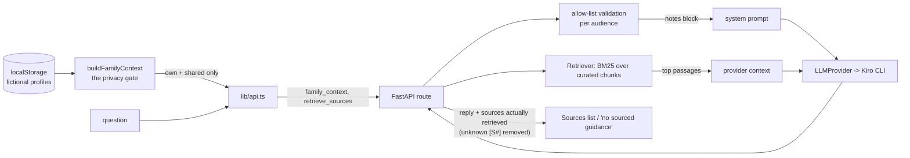
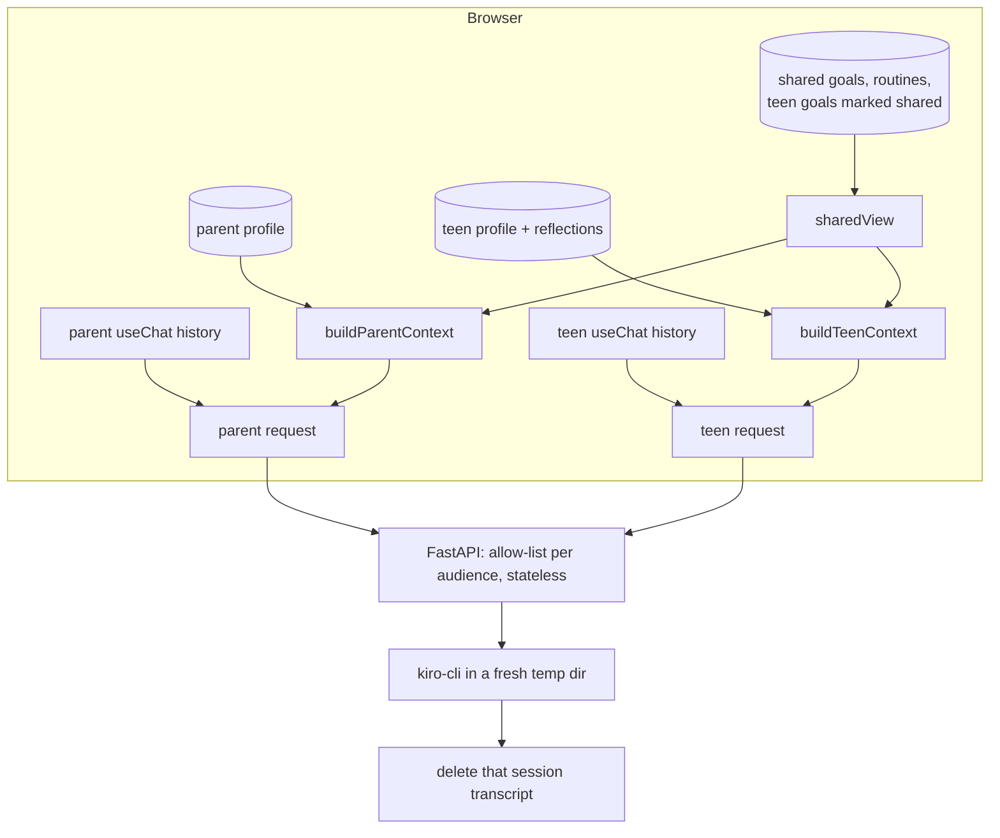

# CommonGround architecture walkthrough

## The big picture



## One request, end to end



## Who is responsible for what

| Piece | Responsibility | Deliberately does NOT |
|---|---|---|
| `lib/api.ts` | Build the request, call `fetch`, 120 s timeout, map HTTP status to an error kind | Show anything to the user; read server error text |
| `hooks/useChat.ts` | Conversation state machine (idle / loading / error), limits, retry, reset, double-send guard | Know about HTTP or rendering |
| Components | Render state, collect input, accessibility | Call `fetch`; hold conversation logic |
| `api/chat.py` | Validate request, add stage to prompt, turn provider errors into HTTP status | Know which LLM is used |
| `prompts.py` | All parenting wording and the stage enum/guidance | Live inside the LLM module |
| `llm/base.py` + `types.py` | The provider-independent contract: `generate_response(...) -> LLMResponse` | Raise for expected failures (returns `error` instead) |
| `llm/kiro_cli.py` | Run the CLI safely, validate exit code/output | Return partial or log-polluted text |

## State machine in `useChat`

```
idle --send--> loading --reply--> idle
                  └--error--> error --retry or send--> loading
any --reset--> idle   (a reply arriving after reset is ignored via a request id)
```
Retry resends the same history; the user's message is already in it, so it is never duplicated. The stage is request
metadata, not a message, and can change at any time without clearing history.

## How errors and timeouts propagate

| Where it fails | Backend result | Frontend `ChatError.kind` | User sees |
|---|---|---|---|
| Bad request / stage | 422 (input not echoed) | `invalid` | "Please check your message..." |
| CLI missing or signed out | provider `not_configured` / `auth_failed` -> 503 | `unavailable` | "isn't available right now" |
| CLI exceeds `LLM_TIMEOUT_SECONDS` (90 s) | `timeout` -> 504 | `timeout` | "That took too long" |
| Non-zero exit, empty or corrupted output | 502 | `failed` | "couldn't put a response together" |
| Backend down, CORS blocked, bad JSON | no valid response | `network` | "Can't reach CommonGround" |
| No answer within 120 s in the browser | n/a (request aborted) | `timeout` | "That took too long" |

The frontend maps by HTTP status and never displays server text, so a backend change cannot leak internals to the UI.
The backend never logs message content or CLI output.

## Swapping in a hosted LLM (for example Gemini)

1. Add `backend/app/llm/gemini.py` implementing `LLMProvider.generate_response`.
2. Register it in `_BUILDERS` in `llm/factory.py`; add its settings to `config.py` and `.env.example`.
3. Set `LLM_PROVIDER=gemini`.
The route, prompts, tests of the route, and the entire frontend are unchanged. That is the reason for the interface.

## Key decisions (interview-ready)

- **Provider abstraction:** the local CLI is a temporary engine; the interface makes it replaceable without touching business logic.
- **Stage as structured metadata:** validated enum, server owns the prompt, history stays clean, nothing the browser sends can inject instructions.
- **Direct browser-to-API with explicit CORS** instead of a proxy: simpler topology, configured by env var, no wildcard, no credentials.
- **Errors mapped by status, copy owned by the client:** safe by construction.
- **Privacy:** conversation lives only in browser memory; no database, storage, cookies or analytics; no content logging.
- **Replies rendered as plain text:** no HTML injection surface and no markdown dependency.

## Known limitations / not implemented

- The Kiro CLI provider works only on a machine where the CLI is installed and logged in. A deployed copy would not work, and a remote judge cannot use a local instance.
- No RAG, citations, evidence grounding, or clinical/expert evaluation. Answers are model output with a stage hint.
- Crisis handling is a single prompt instruction (`SAFETY_LINE`), not a tested protocol.
- Replies take several seconds (no streaming).
- No persistence, accounts, or rate limiting.
- Accessibility was built in and spot-checked, not audited with screen readers; WCAG conformance is not claimed.

## Update: family context and RAG



- **Where the boundary is enforced:** the frontend gate decides what is sent; the backend rejects the other side's private keys (422, values not echoed). Profile notes go in the system prompt, never in message history.
- **Retrieval is deliberately conservative:** a chunk must match at least two distinct meaningful query terms, otherwise nothing is returned and the UI says no sourced guidance was found. Chunks are ~80 words with one sentence of overlap; one best chunk per source; top 3.
- **Swapping retrieval later:** implement `Retriever.retrieve(query, k)` with embeddings or a vector DB and return it from `get_retriever()`. The route does not change.
- **Honesty controls:** every source records how it was verified; the UI labels them as curated summaries; "retrieved" is not presented as "proved"; `cited` only means the model used the marker.
- **Not secure isolation:** no accounts; the browser holds both example profiles.

## Update: conversation-first UI and strict scoping



- **Why separate builders:** the parent builder's inputs are the parent profile and the shared projection, nothing else, so a bug cannot "accidentally" read a teen field; a runtime allow-list (`pick`) is the second guard and the backend allow-list the third. Reflections have no key anywhere.
- **Why not prompt-based hiding:** a model asked to keep one side's secrets can still leak them. Here the other side's data is simply never in the request.
- **Where it is proven:** `frontend/src/lib/family/context.test.ts` (builders), `frontend/src/components/AppShell.test.tsx` (screen + request body, chat histories both directions, toggle, shared goals), `backend/tests/test_privacy_boundary.py` (exact CLI argv, statelessness, logs, retrieval never driven by notes, session cleanup).
- **Logging path found:** kiro-cli writes each call's transcript to `~/.kiro/sessions`. The provider now lists and deletes the session created in its unique temp dir, in the background. A probe confirmed a new call cannot recall an earlier one (memory is disabled for these sessions).
- **UI flow:** `AppShell` holds both `useChat` hooks and the family store; `ChatPanel` (keyed by audience) fills the screen with the audience welcome as its empty state and the `ContextBar` above the composer; context pages are secondary and their action buttons switch back to the chat and send.
- **Still not secure isolation:** one browser holds both example profiles and the switch is not a login.
